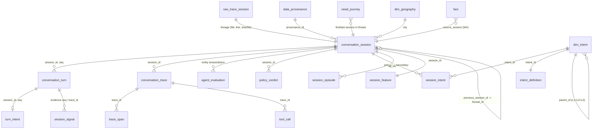

# Canonical data model (schema 1.0.0)

Session-centric, as agreed in the design baseline: **one session = one complete conversation**; traces are
execution records of that conversation (one per turn). Physical schema: `cie/db.py`; column list:
`data_dictionary.md` (generated).

## Grain and keys

| Table | Grain | Key |
|---|---|---|
| `conversation_session` | one complete conversation | `session_id` (source id) |
| `conversation_turn` | one trace = one dialogue turn, ordered | (`session_id`, `seq`); `turn_no` keeps the source number |
| `conversation_trace` / `trace_span` / `tool_call` | execution records | `trace_id`; spans keep `parent_id` + depth |
| `agent_evaluation` | one metric for a session or trace | raw `metric` + `canonical_metric`, value/status/evaluator/rationale kept separately |
| `session_intent` / `turn_intent` | one intent assignment | method, confidence, taxonomy version stored |
| `session_signal` | one signal with evidence | evidence `seq`, `turn_no`, `trace_id`; method + rule version |
| `session_episode` | one need inside a session (`goal`) or the login/IVR span (`access`) | `session_id#ep_no` |
| `need_journey` | same L2 need across a `previous_session_id` thread within 30 days | `J:thread:L2:n` |

## Rules

- Raw payloads are **immutable gzipped files** under `landing/<source>/<day>/`; `raw_trace_session` stores file, line, byte offset and sha256 (raw is ~0.5 MB/session).
- Only `redacted_*` fields are read; a second PII scrub runs at ingest.
- Synthetic rows carry `is_synthetic=1` and a `provenance_id` (batch, scenario, template, generator version, seed).
- Unknowns are explicit: `UNKNOWN` intent, `city='UNKNOWN'`, `geo_source='none'`, evaluator `status` kept (never coerced to 0).
- Session outcome is a **proxy** (`escalated` = transfer tool executed; `abandoned` = disconnect / repeated no-input without handoff; else `resolved_proxy`), with `outcome_basis` recorded. `status_code` is never used as resolution.
- `customer_key` is reserved (nullable) until a pseudonymous customer id is supplied; linkage today is `previous_session_id` only.
